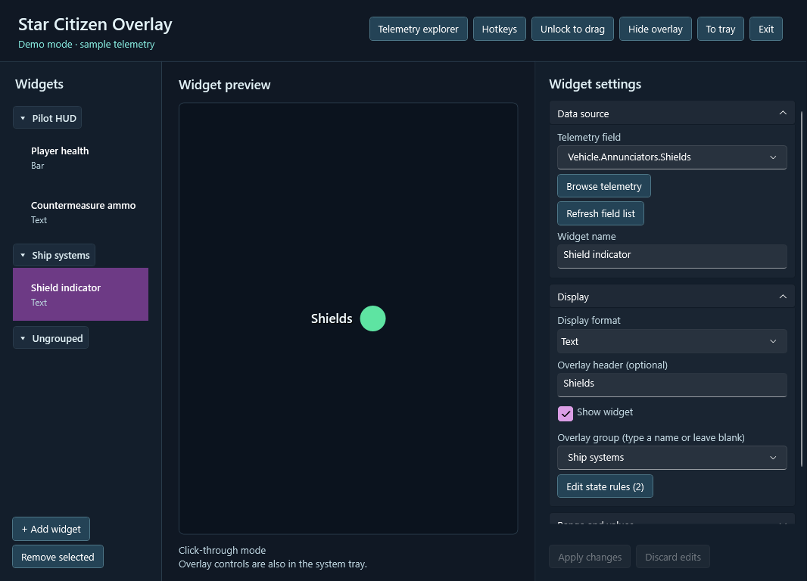
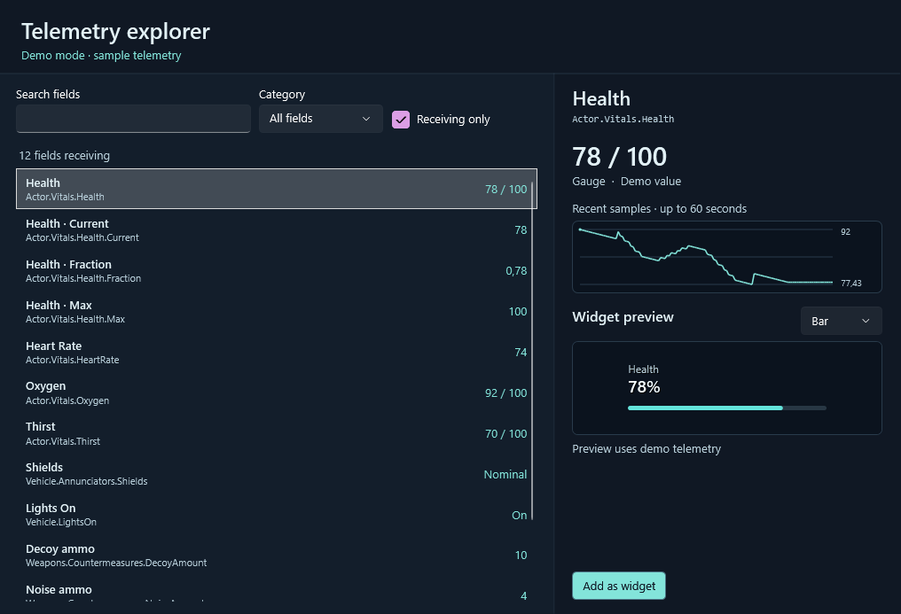
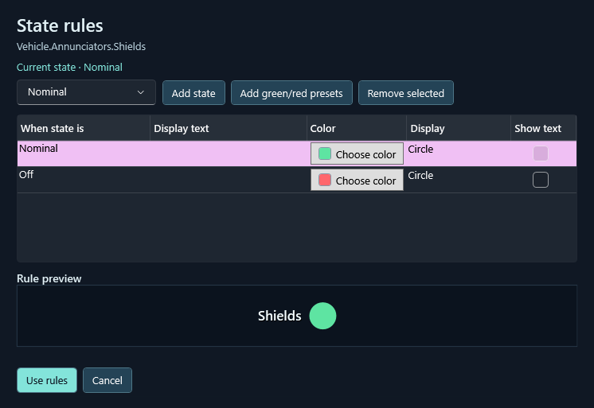

# Star Citizen Overlay

Custom Windows HUD widgets for Star Citizen, powered by [ROBdk97.ScLocalTelemetry](https://www.nuget.org/packages/ROBdk97.ScLocalTelemetry).



## Install

Run `powershell -NoProfile -File .\Install.ps1` from the source folder or beside the published executable. Then search Windows Start for **Star Citizen Telemetry HUD**. Installation is per user.

## Run

Use the .NET 11 SDK to build both Windows targets. The .NET 10 SDK can build the .NET 10 target with `-p:TargetFrameworks=net10.0-windows`.

```powershell
dotnet run --framework net10.0-windows -- --demo
```

For live telemetry, remove `--demo`, set the Windows user variable `GRPC_CLIENT_SERVER_ENABLED=true`, and add `server.game.telemetry.enabled = 1` to the game channel’s `user.cfg`. Restart the RSI Launcher and game, then use borderless or windowed mode. [Telemetry setup guide](https://github.com/ROBdk97/star-citizen-local-telemetry/blob/main/docs/setup.md)

## Controls

| Control | Action |
| --- | --- |
| Ctrl+Alt+F9 | Toggle HUD drag and click-through modes |
| Ctrl+Alt+F10 | Hide or show the HUD |
| Drag a HUD widget | Move its group |
| Shift+drag a HUD widget | Move only that widget |
| Drop a widget on a group in the list | Move it to that group. Drop on **Ungrouped** to remove it |

Create groups with **Overlay group** and expand or collapse them with their arrows. Use **Telemetry explorer** to browse fields and preview widgets. **Edit state rules** maps states to colors, circles, and optional text. Game-action hotkeys require a build that advertises those actions.

## Screenshots





## Voice commands

Open **Hotkeys → Voice commands** or use the tray menu. Pick a **Push-to-talk key** (default **F8**), optionally with **Shift** or **Alt**, and apply the settings. Hold that key while saying a phrase such as **hide overlay**, then release it. A sound confirms whether a phrase matched. Select your microphone, use **Test microphone** to check its level and recognition, then apply the settings. Edit phrase bindings in the same menu.

Windows Speech uses an installed Windows recognizer. The optional **Voicebox** backend uses a running local server at `http://127.0.0.1:17493`. Game commands use the same action support and foreground checks as hotkeys. Audio is captured only while the shortcut is held and is kept in memory.
